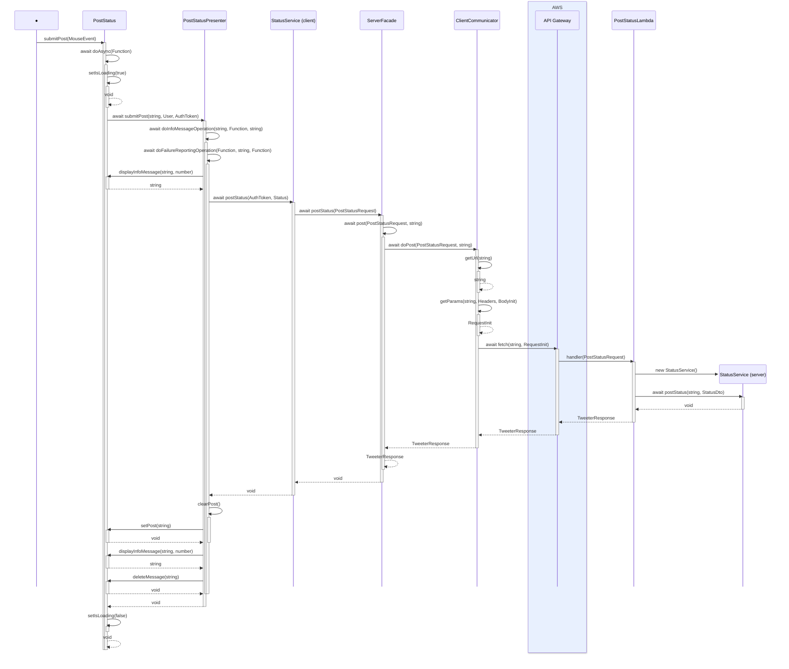

# Successful status post

`submitPost(MouseEvent)` starts at the filled circle. The circle is not an object. After the success message, the presenter deletes that toast and returns `void` to `PostStatus`, which then finishes `doAsync`.

